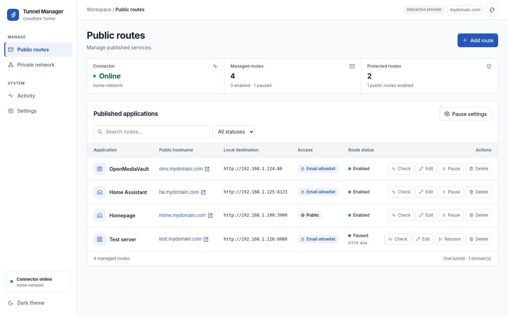
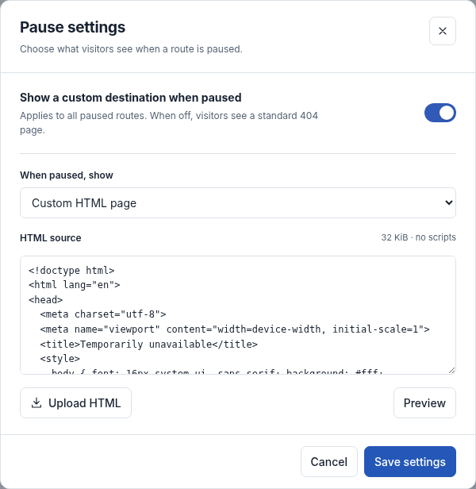

<h1 align="center">Tunnel Manager</h1>
<p align="center">A self-hosted web interface for Cloudflare Tunnel.</p>
<p align="center">
  <a href="#installation">Installation</a> ·
  <a href="#configuration">Configuration</a> ·
  <a href="#updating">Updating</a> ·
  <a href="docs/administration.md">Documentation</a>
</p>



Tunnel Manager publishes local HTTP and HTTPS services through Cloudflare Tunnel without a public IP address or inbound port forwarding. One connector can reach multiple services on the local network. DNS and tunnel configuration are handled through the web interface.

## Features

- **Routing** — create, edit, pause and resume public hostnames; DNS records are managed automatically.
- **Access control** — public routes, Cloudflare Access email allowlists and private IP routes.
- **Maintenance pages** — custom HTML, temporary redirects or an alternate origin for paused services.
- **Monitoring** — connector status, connection checks and activity logs.
- **Deployment** — native Alpine Linux or Docker Compose; no frontend build step.

## Installation

Requirements: an active Cloudflare domain, a Linux host with access to the local services, and outbound connectivity to Cloudflare.

Download or clone the repository. Run the appropriate installer from the project directory.

### Alpine Linux / Proxmox LXC

```sh
sh install-alpine.sh
```

Run as root inside an Alpine container. A starting allocation of 1 CPU, 256–512 MB RAM and 1 GB storage is recommended.

### Docker Compose

```sh
sh install.sh
```

Requires Docker Engine and Compose v2. The installer generates the administrator password and starts the service. Open the dashboard at `http://<server-ip>:8080` using the credentials printed by the installer.

## Configuration

1. Sign in to the dashboard.
2. Create a scoped API token at [Cloudflare API Tokens](https://dash.cloudflare.com/profile/api-tokens). The setup screen includes the permission guide.
3. Paste the token and choose a tunnel.
4. Add a route using a hostname, local IP address and port.

No API token or manually prepared configuration file is required before installation.

<details>
<summary>Cloudflare API permissions</summary>

| Scope | Permission | Access |
| --- | --- | --- |
| Account | Cloudflare Tunnel | Edit |
| Account | Access: Apps and Policies | Edit |
| Account | Access: Organizations, Identity Providers, and Groups | Read |
| Account | Cloudflare One Networks | Edit |
| Zone | Zone | Read |
| Zone | DNS | Edit |

Restrict the token to the account and domains to be managed. Access and private-network permissions support their respective features.

</details>

<details>
<summary>Maintenance page configuration</summary>



</details>

## Updating

For a native Alpine installation, run from the updated source directory:

```sh
sh update-alpine.sh
```

For Docker:

```sh
docker compose build --pull
docker compose up -d
```

Runtime configuration and credentials are retained. Back up runtime data before updating.

## Documentation

[Administration guide](docs/administration.md) · [Changelog](CHANGELOG.md) · [Security](SECURITY.md)

The application manages one remotely configured tunnel per installation. Existing external ingress rules are read-only. Keep the management interface on a trusted network. This project has not undergone an independent security audit.
